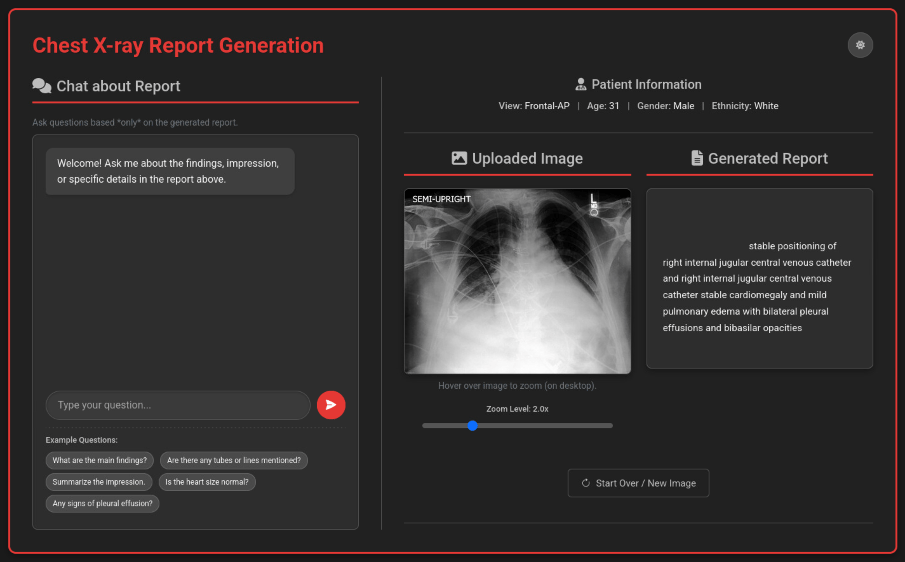
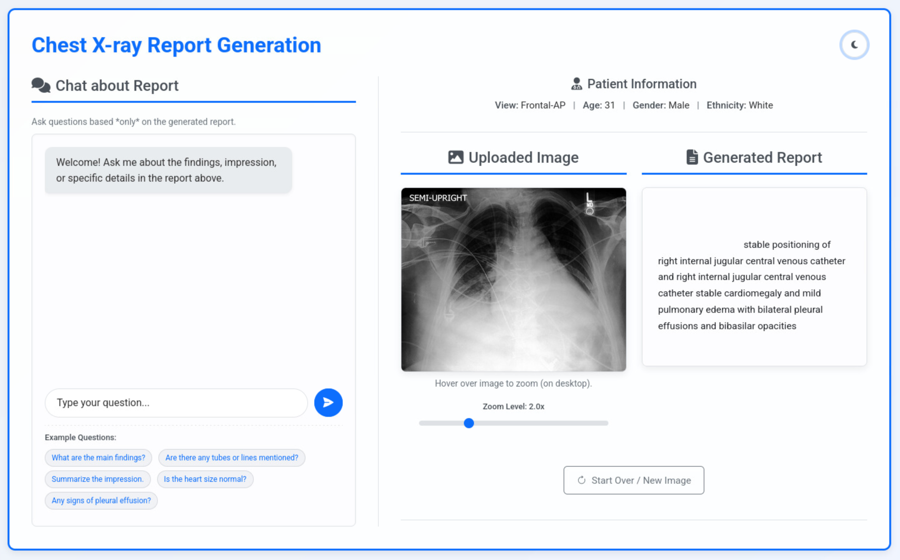
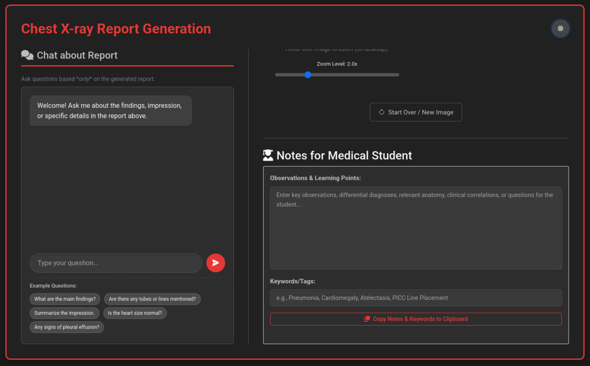
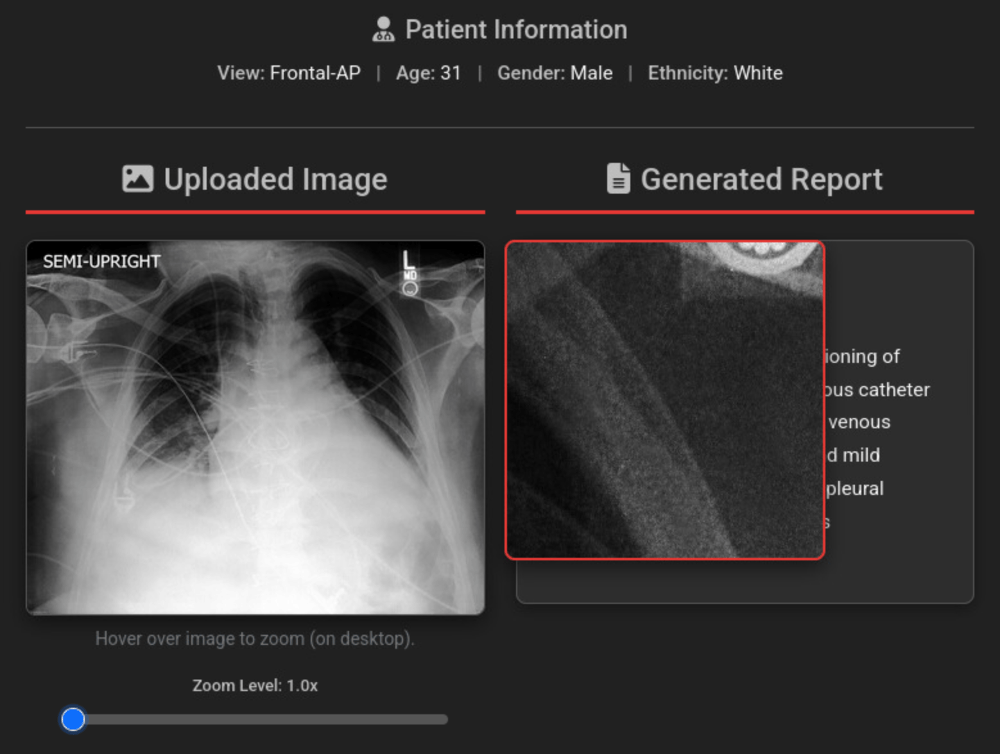
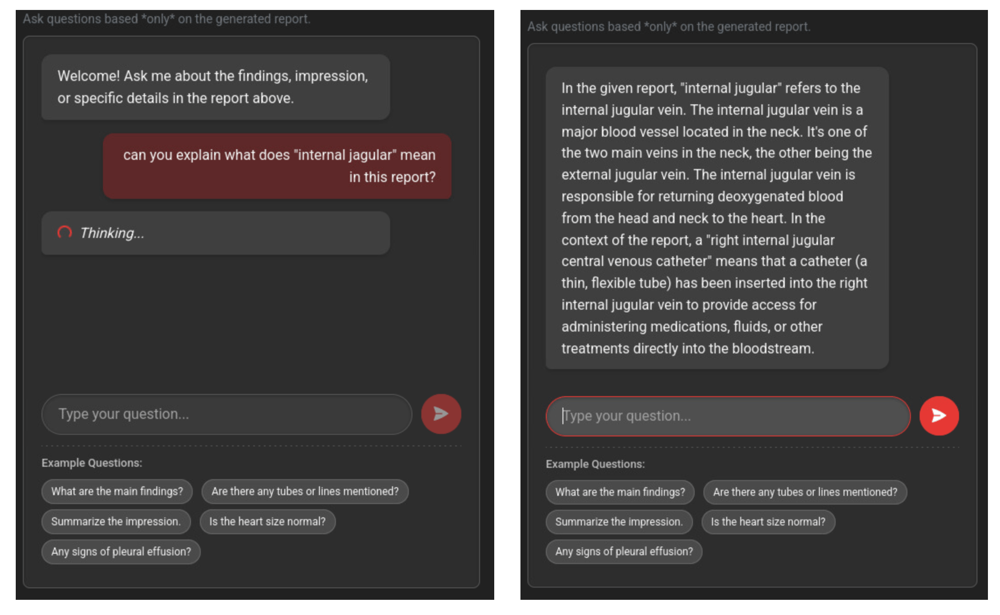
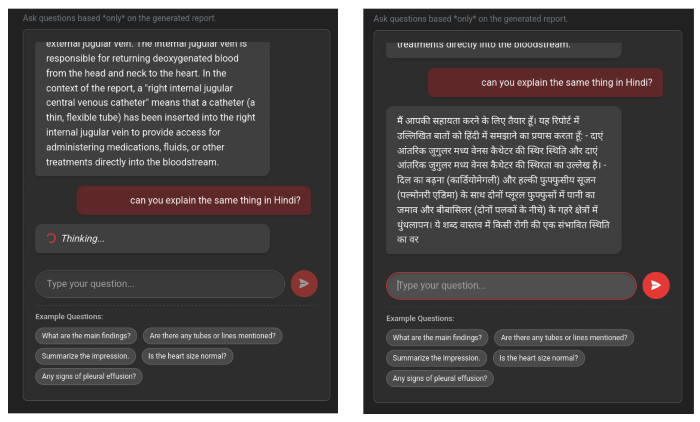
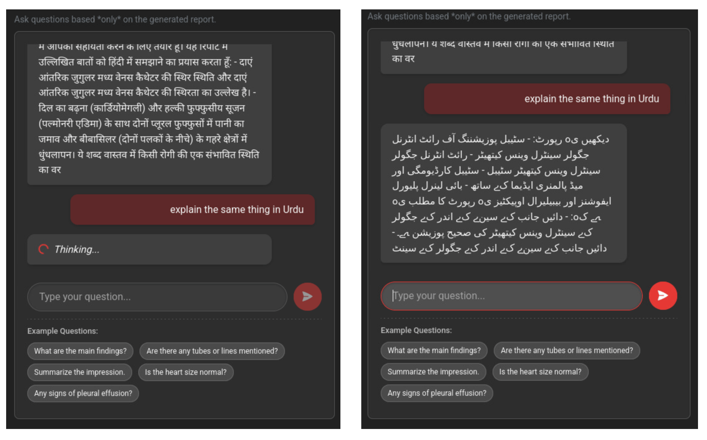
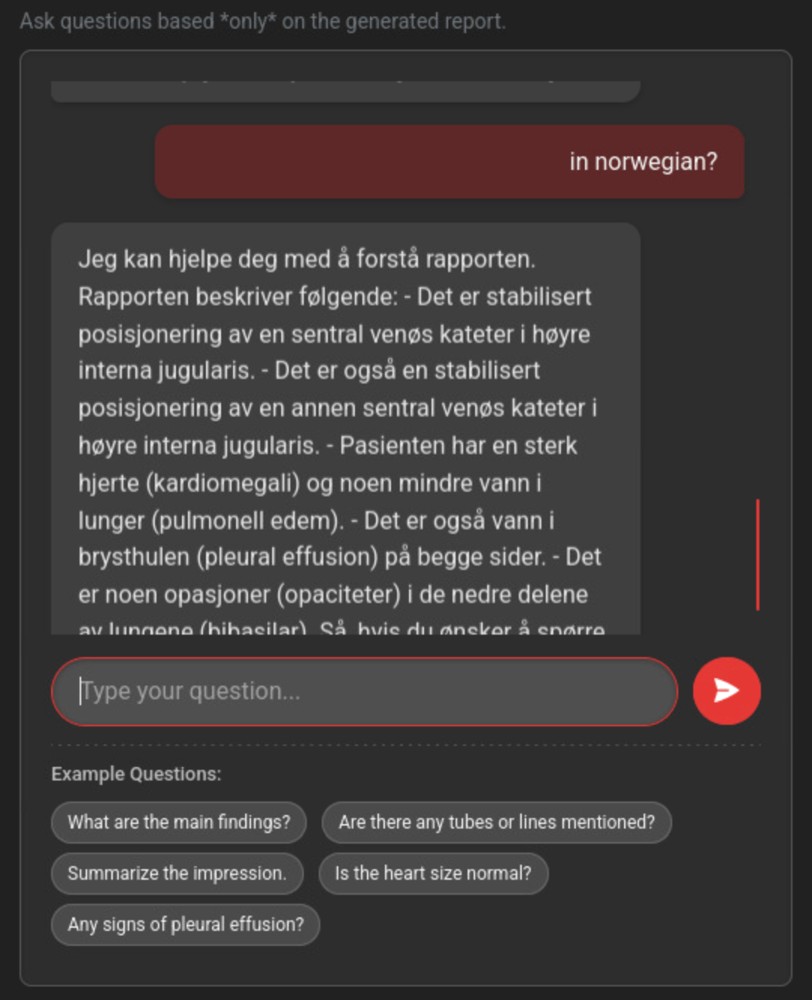

# 🩺 Chest X-ray Report Generation with Vision-Language & Multilingual LLMs

A cutting-edge web application that leverages Vision-Language Models (VLMs) and Large Language Models (LLMs) to generate detailed, radiology-style reports from chest X-ray images. The app also features a multilingual, context-aware chatbot for interactive medical Q&A and educational note-taking.

---






---

## 🚀 Key Features

- **Automated Chest X-ray Report Generation**  
  Generate comprehensive, medical-style reports from X-ray images using state-of-the-art VLMs (Swin-T5, Swin-BART, BLIP).

- **Multilingual, Contextual Chatbot**  
  Interact with a powerful LLaMA-3.1-based chatbot for contextual Q&A in multiple languages (Hindi, Urdu, Norwegian, and more).

- **Educational Note-Taking**  
  Take structured notes directly within the app—ideal for students and educators.

- **Intuitive UI**  
  Enjoy a modern, responsive interface with dark/light mode and zoomable image previews.

- **Performance Metrics**  
  Evaluate generated reports using the ROUGE-1 metric.

- **Privacy-First**  
  No external API dependencies (except optional Hugging Face model access).

---

## 🧠 Models & Data

- **Vision-Language Models:**  
  - [BLIP](https://huggingface.co/Salesforce/blip-image-captioning-base)  
  - [Swin-BART](https://huggingface.co/)  
  - [Swin-T5](https://huggingface.co/)  
- **Large Language Model:**  
  - [LLaMA3-8B Instruct](https://huggingface.co/meta-llama/Meta-Llama-3-8B-Instruct)
- **Dataset:**  
  - [CheXpert Plus (155GB subset)](https://stanfordaimi.azurewebsites.net/datasets/5158c524-d3ab-4e02-96e9-6ee9efc110a1)
- **Best Model Weights:**  
  - [Swin-T5 Weights](https://studntnu-my.sharepoint.com/personal/aleksace_ntnu_no/_layouts/15/onedrive.aspx?id=/personal/aleksace_ntnu_no/Documents/InnovationProject/swin-t5-model.pth&parent=/personal/aleksace_ntnu_no/Documents/InnovationProject&ga=1)

---

## 🏗️ Architecture Overview

A modular monolithic design with clear separation of concerns:

- `app.py` — Flask application entry point
- `vlm_utils.py` — Vision-Language model loading & inference
- `chat_utils.py` — LLM-powered chatbot logic
- `preprocess.py` — Image preprocessing & metadata extraction
- `templates/` — Jinja2 HTML templates
- `static/` — CSS, JavaScript, and assets

---

## 🛠️ Technology Stack

| Layer         | Technology                                   |
|---------------|----------------------------------------------|
| **Backend**   | Python, Flask, PyTorch, Hugging Face         |
| **Frontend**  | HTML5, CSS3, JavaScript, Bootstrap           |
| **Deep Learning** | Swin-T5, LLaMA-3, BLIP, Torchvision      |
| **Deployment**| Docker, NVIDIA CUDA, Git, GitHub             |
| **Dev Tools** | Visual Studio Code                           |

---

## ⚡ Getting Started

### Prerequisites

- Python 3.9+
- CUDA-enabled GPU (recommended)
- Docker (optional, for containerization)

### Setup Instructions

```bash
# 1. Clone the repository
git clone https://github.com/ammarlodhi255/Chest-xray-report-generation-app-using-VLM-and-LLM.git
cd Chest-xray-report-generation-app-using-VLM-and-LLM

# 2. Create a virtual environment
python -m venv venv
# On Windows:
venv\Scripts\activate
# On macOS/Linux:
source venv/bin/activate

# 3. Install dependencies
pip install -r requirements.txt

# 4. (Optional) Set Hugging Face token for private LLaMA access
# On Windows:
set HF_TOKEN=your_token_here
# On macOS/Linux:
export HF_TOKEN=your_token_here

# 5. Launch the application
python app.py

# Visit the app at:
http://127.0.0.1:5000
```

---

## 💬 LLM Interactions

Interact with the chatbot in multiple languages and contexts:






---

## 🤝 Contributing

Contributions, issues, and feature requests are welcome!  
Feel free to fork the repo and submit a pull request.

---

## 📄 License

This project is licensed under the MIT License.

---

## 🙏 Acknowledgements

- [Stanford AIMI CheXpert Dataset](https://stanfordaimi.azurewebsites.net/)
- [Meta LLaMA](https://huggingface.co/meta-llama)
